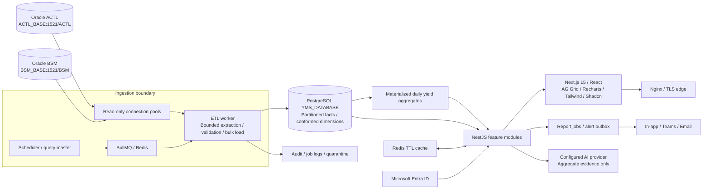
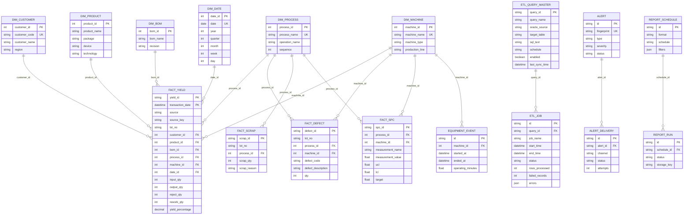

# Solution architecture



The API has no Oracle import and its production container receives no Oracle credentials. SQL tests and manual runs enqueue work; the isolated worker performs Oracle access. Use network ACLs to prevent API/frontend hosts reaching Oracle listeners, in addition to the code boundary. All dashboard endpoints operate on PostgreSQL facts, dimensions or materialized aggregates.

The API is organized into platform, analytics, lots, ETL administration, alerts, SPC, reporting and Copilot modules. Analytics, authentication, report generation and AI transport are services; core validation and SPC functions have no infrastructure dependencies. The ETL separates extraction, loading, alert evaluation and orchestration. Shared data contracts validate externally supplied inputs.

## Star schema ER diagram



Fact grain: one immutable source operation transaction, with stable source key and event timestamp. Dimensions are conformed across ACTL/BSM. Cross-source identifiers must be normalized in extraction SQL or a controlled mapping before ingestion. Factory, shift and operator are degenerate dimensions in this release. Manufacturing engineering owns process sequence, definition of rework, control limits and source cost currency.

## Production folder structure

```text
apps/
  web/src/app/             Responsive application shell and views
  web/src/components/     Lazy chart/grid components and Shadcn button
  web/src/lib/            Entra/MSAL and authenticated API transport
  api/src/modules/        Feature controllers and NestJS modules
  api/src/analytics.ts    Parameterized PostgreSQL analytics / caching
  api/src/auth.ts         Entra verification / RBAC
  api/src/reporting.ts    Reusable document exporters
  api/src/copilot.ts      Provider adapters / grounded prompt
  etl/src/oracle.ts       Oracle source pools / bounded extraction
  etl/src/loader.ts       Validation / conformed dimensions / bulk upsert
  etl/src/alerts.ts       Rule evaluation / delivery outbox
  etl/src/main.ts         Worker / scheduler / checkpoints / locks
packages/core/src/        Shared schemas and statistical calculations
database/                Prisma schema / PostgreSQL / Oracle examples / seed
docker/                  Linux images / Nginx
tests/                   Domain, auth, exports, integration and load harness
docs/                    Architecture / contracts / API / deployment / operations
```
