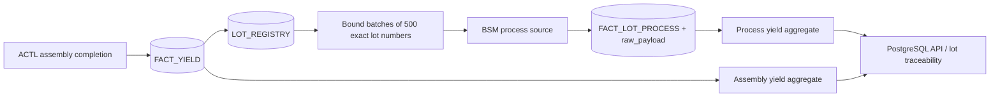
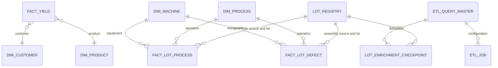

# Assembly lot enrichment

FACT_YIELD stores ACTL assembly completion summaries. Its current-operation field does not represent process yield. LOT_REGISTRY identifies each parent by assembly source and exact lot number, excluding sample data. FACT_LOT_PROCESS stores BSM process events; FACT_LOT_DEFECT stores detailed defect events. Both reference the parent and conformed dimensions. Dashboards query PostgreSQL only.



## Process SQL and mapping

`database/source2_lot_process.sql` implements the supplied SQL with `LOT IN (:LOT_LIST)` instead of embedded literals. Each parent lot number is bound as a JDBC string. No prefix, sublot, padding or case conversion is assumed. `AREA_CODE <> 'TEST'` preserves the supplied Oracle behavior, including exclusion of null AREA_CODE. Rows are ordered by lot and operation sequence. Oracle metadata confirms primary key `(LOT, OPERATION_SEQ)`; SOURCE_KEY uses that stable key. All `a.*` columns are retained in `raw_payload` alongside normalized aliases.

The job **BSM assembly lot process history** uses source 2, FACT_LOT_PROCESS, assembly_lots scope, parent source 1, full load and 500 lots per query. The initial historical run completed. The process job is now enabled and configured to run after AEY, with full mode. Full execution queries every stored parent lot. Checkpoints record matched, unmatched and review outcomes. No matching row means unavailable history, not zero yield. A separate defect SQL is still required: QTY_REJECT cannot identify defect causes.

Required process aliases: SOURCE_KEY, LOT_NO, PROCESS_NAME. Optional: SOURCE_LOT_NO, PROCESS_CODE, OPERATION_SEQUENCE, MACHINE_ID, STARTED_AT, COMPLETED_AT, INPUT_QTY, OUTPUT_QTY, REJECT_QTY, REWORK_QTY, STATUS, OPERATOR, SHIFT. Defect targets additionally require DEFECT_CODE, DEFECT_DESCRIPTION and QTY.

Quantities remain nullable. Missing input/output marks a row incomplete; invalid quantities or impossible balances flag it for review while preserving the record. Only valid rows with a completion timestamp enter process yield analytics. LP_YIELD remains available in raw data; normalized yield is OUTPUT_QTY / INPUT_QTY. First-pass and rework cards remain unavailable until appropriate source data exists. Assembly charts use assembly completion dates; process charts use process completion dates.

## Modes and progress

Saving increments query version and checks the version supplied by the editor, preventing stale overwrites. Every queued execution has an immutable configuration snapshot. Edits affect subsequent runs. The log shows effective mode/version, live phase, accepted rows, quality failures, rows read, batches, and checked lots / cohort total. Percentage measures checked lots and reaches 100% after aggregate refresh. Ordinary scans without a known total show counts and phase.

Full mode re-reads and upserts all parent lots. Incremental requires an approved source change-date predicate with both :LAST_SYNC_TIME and :SYNC_END_TIME bounds. Do not select incremental for the supplied SQL without adding a reliable update predicate. Delta skips parent lots already matched by the same query version and inserts without updating; later-added processes on those lots require full or verified incremental synchronization. Full load does not delete source-missing records. Parent lots added after a cohort starts are included next run.

Tests read up to five rows from the first lot batch and do not write manufacturing records. Retries safely replay committed batches using the source key. Retries of the same queued execution resume unchecked lot batches from durable checkpoints. A new full execution still scans the whole cohort. A resumed attempt reports its remaining cohort total. Accepted-upsert counts include replayed records and are not counts of newly inserted rows.

## Database inspection

Use the PostgreSQL connection in deployment.md. For example:

```sql
SELECT * FROM fact_yield WHERE lot_no='your lot';
SELECT * FROM fact_lot_process WHERE assembly_source='1' AND lot_no='your lot' ORDER BY operation_sequence;
SELECT raw_payload FROM fact_lot_process WHERE assembly_source='1' AND lot_no='your lot' ORDER BY operation_sequence;
SELECT * FROM fact_lot_defect WHERE assembly_source='1' AND lot_no='your lot';
SELECT * FROM lot_enrichment_checkpoint WHERE query_id='your query id' ORDER BY processed_at DESC;
```

Apply database/006_lot_history.sql to existing databases before generating Prisma and starting the upgraded services. Fresh Compose deployments mount it automatically. Back up the warehouse before upgrading. The API can read the new tables/views; the ETL worker owns the process materialized view for refresh.

## Relationships



A source MACHINE value listing several machines is retained as an equipment group. Its aggregate quantities cannot safely be allocated to individual machines without a separate equipment transaction query. Process charts refresh when the execution completes; lot detail can inspect committed process records during the import.

## Automatic update following AEY

The configured chain is AEY (ACTL assembly summary) → BSM assembly lot process history (full source-2 enrichment) → refreshed PostgreSQL process charts. The child job is enabled and depends_on_query_id points to AEY. It inherits execution timing from AEY rather than using an independent timer. Changing AEY cadence consequently changes how often follow-ups are requested.

After AEY's non-test execution reaches success or partial, the worker commits a durable follow-up request with the parent completion status. Partial imports still trigger enrichment for accepted FACT_YIELD lots. Tests and failed executions do not trigger a child. The scheduler dispatches pending requests within its 30-second polling interval; it waits while that child query is already queued or running. Unique parent-execution/child-query pairs and stable queue IDs prevent repeated completion handling from duplicating requests. Pending requests survive worker/Redis interruptions, and completed child history reconciles an enqueue interrupted before its dispatch acknowledgment.

Full mode queries all current assembly lot numbers, including previously matched ones. This is necessary to detect process quantity, machine, status, or completion corrections without an approved source update timestamp. Incremental or delta can miss those changes unless their source predicates cover them. The SQL uses read-only JDBC string binds; quantities and source event keys are upserted without duplicating process records. Full reconciliation does not delete source-missing records.

ETL control shows `After AEY · On` in the query list. The editor provides **Run automatically after assembly job** and **Enable automatic execution**. The **Automatic follow-up jobs** table links each parent execution to its child status. The synchronization log shows extraction/loading/refresh phases and final completion. Verify AEY completes, its follow-up is queued, then the process job completes. Once both are complete, lot detail and process charts reflect the refreshed PostgreSQL data. A pending or failed child means the assembly update has not yet completed its process refresh.

Existing deployments must also apply database/007_etl_dependencies.sql, generate Prisma, and restart API/ETL. Fresh Compose initialization mounts it. Only administrators can configure dependency links; the API rejects self-dependencies, incompatible sources and non-assembly parents.

## Lot materials

Apply database/008_lot_material.sql to existing PostgreSQL deployments; fresh Docker initialization includes it. Source-2 SQL is database/source2_lot_material.sql, using PROMIS.BWIP_LOT_MATERIAL (not PROMIS2). The provided lot equality is expanded into bound IN (:LOT_LIST) batches of existing assembly lots. Stored fields: lot, sequence, item group, size/type, item number, material lot number. Nullable material fields stay null. Raw returned fields are retained.

BSM assembly lot materials is enabled with Run after AEY and full mode. The first historical import was queued manually; subsequent AEY success/partial completions trigger the durable dependency scheduler. Records upsert by source and lot + sequence; full mode refreshes returned records but does not remove records deleted from Oracle. Conflicting duplicate keys fail validation rather than overwrite silently. Lot details show Materials ordered by sequence, with 100-row pagination. GET /api/lots/:lot?materialPage=1 returns materials, materialTotal and materialPage from PostgreSQL only.

## Lot rejects / defects

Source SQL: database/source2_lot_reject.sql reads PROMIS.BWIP_LOT_REJECT from Oracle source 2. All ten supplied columns are retained in fact_lot_defect.raw_payload. Normalized reject code/description, reject quantity, rework quantity, and operation sequence are also stored directly. The confirmed source primary key is LOT + OPERATION_CODE + REJECT_CODE; the length-prefixed SOURCE_KEY preserves this key without delimiter collisions. Missing descriptions display the reject code while the raw source description remains null. Missing/invalid reject quantities are preserved with quality flags and excluded from valid defect aggregates.

The query uses bound assembly lot batches (IN (:LOT_LIST)), and a left join to the unique process LOT + OPERATION_SEQ key plus matching OPERATION_CODE supplies process description, area, machine and process completion time when available. Completion time is contextual process time, not a proven defect occurrence time; no timestamp is fabricated for an unmatched process. Unlike the process-history import, this reject SQL does not exclude TEST records because the provided query has no area restriction.

Enabled job: BSM assembly lot rejects, source 2, FACT_LOT_DEFECT, assembly_lots source 1, full mode, 500 lots per batch, Run after AEY. Successful/partial AEY completions create durable follow-up requests, including manual reruns and later assembly updates. Full mode rechecks existing lots and updates corrections; it does not delete records removed from Oracle. A checked lot with no returned rows gets an unmatched checkpoint, not a fabricated zero-reject row. Source matching uses exact lot numbers.

Initial historical backfill is asynchronous across all assembly lots. Monitor ETL Control processed/total lots, imported rows, failures and follow-up execution status. Freshness follows completion of the reject job, not completion of AEY alone. Lot details show rejects by operation/area, quantity, rework and external reject codes. Defect analysis reads valid records only from PostgreSQL; dashboard access never queries Oracle.
